

  <picture>
    <source media="(prefers-color-scheme: dark)" srcset="assets/witness360_logo_sombre.png">
    
  </picture>

# witness360

Tracking caméra aidé par une caméra 360 « témoin » montée sur le rig, livré dans Blender avec un HDRI de la scène.

La caméra 360 voit tout autour du rig et enregistre son gyroscope. Fixée à la caméra du plan, elle donne la rotation
exacte du rig à chaque image, la verticale, et l'éclairage complet de la scène. witness360 s'en sert pour tracker le
plan, résoudre la caméra et créer un HDRI étalonné sur le plan, puis envoie le tout dans Blender.

Ce dépôt sert à distribuer les versions compilées de witness360 (Windows et Mac). Le code source est dans un dépôt privé.

## Télécharger

**[Dernière version](../../releases/latest)**

| Système | Fichier |
|---|---|
| Windows 10 / 11 (64 bits) | `witness360-X.Y.Z-windows-x64.zip` |
| Mac Apple Silicon (M1 et plus récents), macOS 12 ou plus | `witness360-X.Y.Z-macos-arm64.zip` |

**Windows** : décompressez le zip dans un dossier à vous (par exemple `Documents\witness360`) et lancez `witness360.exe`.
Si Windows affiche « Windows a protégé votre ordinateur », cliquez sur « Informations complémentaires » puis « Exécuter quand même ».

**Mac** : décompressez le zip et glissez `witness360.app` dans `Applications`. L'appli n'est pas encore signée par Apple :
au premier lancement, ouvrez Réglages Système > Confidentialité et sécurité, puis « Ouvrir quand même ». Si macOS dit que
l'appli est endommagée, tapez dans le Terminal : `xattr -dr com.apple.quarantine /Applications/witness360.app`.
Sur Mac, les raccourcis passent par ⌘ (Générer l'HDRI : ⇧⌘H), le pavé tactile déplace l'image (deux doigts) et zoome
(pincer).

**Vérifier l'installation** : `witness360 --autotest DOSSIER` (sur Mac :
`/Applications/witness360.app/Contents/MacOS/witness360 --autotest ~/Desktop/autotest`) fabrique un tournage de
synthèse dont tout est connu, passe toute la chaîne et compare chaque résultat à la vérité (10 à 20 minutes).

## Premiers pas

Au premier lancement, une **visite guidée** de 2 minutes montre le chemin, salle par salle. Elle reste dans le menu
Aide, avec le **guide complet** (F12) : principe, matériel au tournage, formats, exemples de rigs, lecture des
résultats, dépannage et raccourcis.

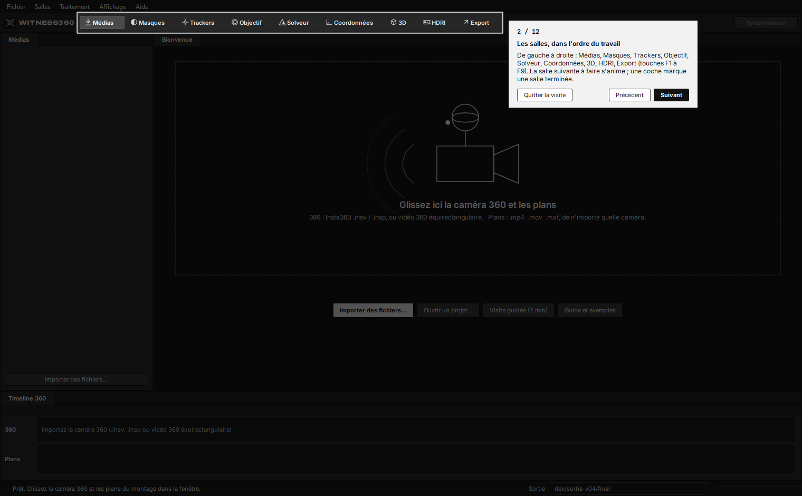

Les salles se suivent dans l'ordre du travail (F1 à F9). La prochaine salle conseillée s'anime, une coche marque les
salles faites. Chaque salle a son **aide** (bouton « ? », Maj+F1) : étapes, un exemple chiffré et des conseils.
Chaque réglage a une bulle d'aide avec un exemple.

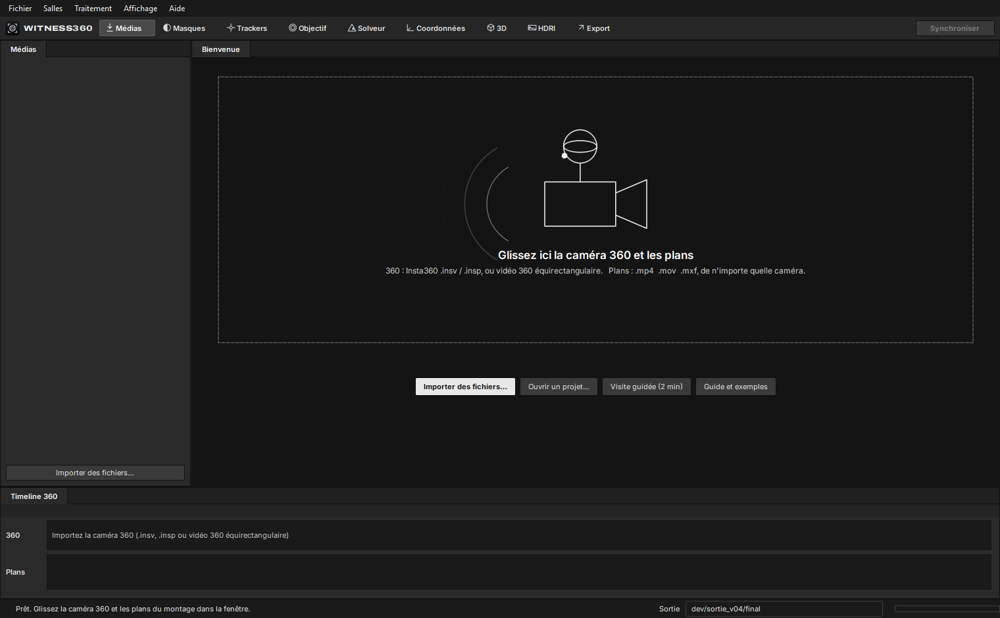

## Ce qu'il faut au tournage

- Le 360 vissé sur le rig de la caméra (griffe flash, poignée, cage) : il ne doit pas bouger par rapport à la caméra
  pendant la prise.
- Le son enregistré par les deux caméras (le micro interne suffit), pour la synchro. Sans son commun (montage sur
  une musique), les plans qui bougent se retrouvent par l'image.
- Le 360 en vidéo non stabilisée (le .insv d'origine).
- Une focale fixe pendant le plan (pas de zoom).
- Utile : la position du 360 par rapport à la caméra et la hauteur de la caméra, mesurées au mètre ruban.

## Formats pris en charge

| Élément | Formats |
|---|---|
| Caméra 360 | Insta360 .insv (un fichier, deux flux ou deux fichiers …_00_ / …_10_) et photos .insp ; vidéos et images 360 équirectangulaires de toute marque (export Insta360 Studio, GoPro Player…). Le gyroscope est lu dans les .insv. |
| Plans | .mp4, .mov, .mxf, .m4v de toute caméra, toute cadence, toute résolution, rushes longs compris |
| Courbes de couleur | Sony S-Log3 (S-Gamut3.Cine ou S-Gamut3), Panasonic V-Log, Canon Log 3, ARRI LogC3, Fujifilm F-Log, Apple Log, HLG, Rec.709 |
| Métadonnées lues | Boîtiers Sony (boîtier, objectif, focale image par image, largeur du capteur), étiquettes QuickTime des autres caméras |
| Sorties | Alembic .abc, Blender .blend (plaque, cadence, HDRI), HDRI .exr linéaire, projet .w360 |

Rien n'est propre à un tournage dans l'appli : l'horloge et les axes du gyroscope, l'angle du rig, la latence de la
caméra et l'angle de vue du plan sont mesurés sur les fichiers.

## Exemple : une scène réelle, pas à pas

Scène de test : 2 plans tournés à la Sony FX3 en 4K (3840 × 2160, 25 i/s, S-Log3) avec une Insta360 ONE X2 vissée
sur le même rig. Le fichier 360 dure 9 min 53 s. Les plans durent 11 s et 9 s.

### 1. Importer et synchroniser

On glisse le fichier 360 et les plans dans la fenêtre, puis on clique sur **Synchroniser** (Ctrl+R).
witness360 retrouve chaque plan dans la 360 par le son et le place sur la timeline 360.

| Plan | Début retrouvé dans la 360 | Contrôle | Fiabilité |
|---|---|---|---|
| PLAN_1 (296 images) | 00:03:03:11 (183,542 s) | 3 morceaux à ±0,5 ms | Sûre |
| PLAN_2 (238 images) | 00:04:04:09 (244,540 s) | 3 morceaux à ±1,9 ms | Sûre |

Le contrôle recale 3 morceaux de chaque plan séparément. S'ils retombent au même endroit à moins d'une demi-image près,
la synchro est « Sûre ». Un rush plus long que le 360, ou qui ne le recouvre qu'en partie, est accepté : sa
**plage de travail** se cale sur la partie couverte par le 360 et se règle dans Propriétés. Sans son commun, la
synchro se fait à la main.

### 2. Tracker le plan

Salle **Trackers** : l'auto-track suit des centaines de points image par image, avec un contrôle aller-retour.
Couleur : vert = suivi 40 images ou plus, jaune = 20 à 39, rouge = moins de 20. La timeline montre le nombre de
trackers actifs sur chaque image.

L'aide de la salle donne les étapes, un exemple chiffré et les réglages à toucher selon le plan :

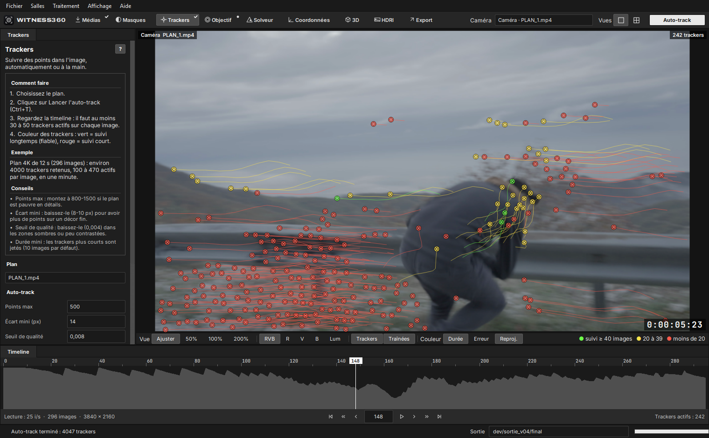

La salle **Masques** exclut du tracking les zones qui ne suivent pas le décor (personnes, reflets, écran).

### 3. Objectif : focale et angle de vue

Salle **Objectif** : caméra, largeur du capteur et focale, lues dans les métadonnées quand elles existent.
**Mesurer sur le 360** retrouve le plan dans l'image 360 à plusieurs instants : on en tire l'angle de vue réel du
plan, donc la focale, et l'angle exact du rig.

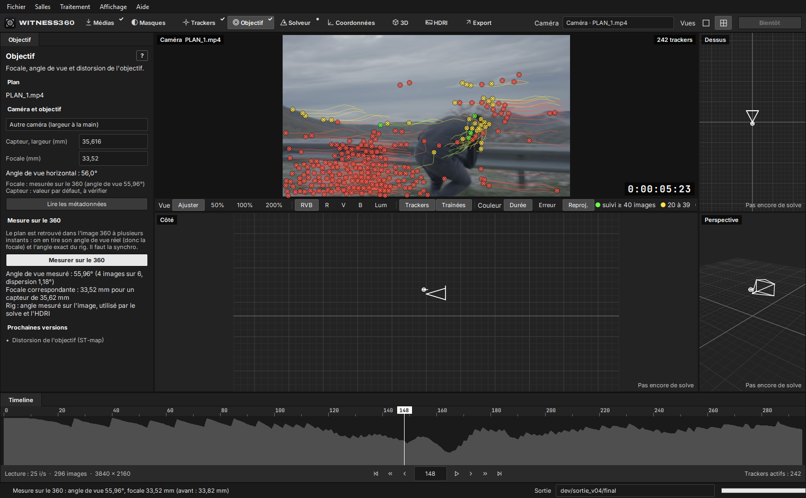

| Plan | Angle de vue mesuré sur le 360 | Mesure de référence |
|---|---|---|
| PLAN_1 | 55,96° | 55,7° |
| PLAN_2 | 52,47° | 52,8° |

### 4. Résoudre la caméra (solve)

Salle **Solveur**, bouton **Résoudre** (Maj+G). Le gyroscope du 360 donne la rotation du rig à chaque image ; l'appli
cale seule son horloge sur les trackers du plan (sur cette scène, l'image de la caméra arrive 132 à 137 ms après le
son). Les trackers donnent la position de la caméra et des points. L'accéléromètre donne la verticale ; la hauteur
de la caméra donne l'échelle.

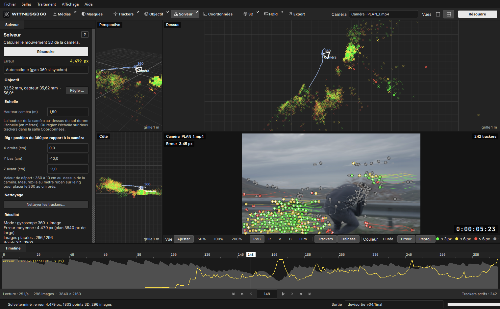

**Nettoyer les trackers** (Maj+C) retire les mauvaises images, les trackers à forte erreur, les trackers courts et les
sauts, puis affine le solve : 2,91 px sur PLAN_1 et 2,08 px sur PLAN_2 (pixels 4K).

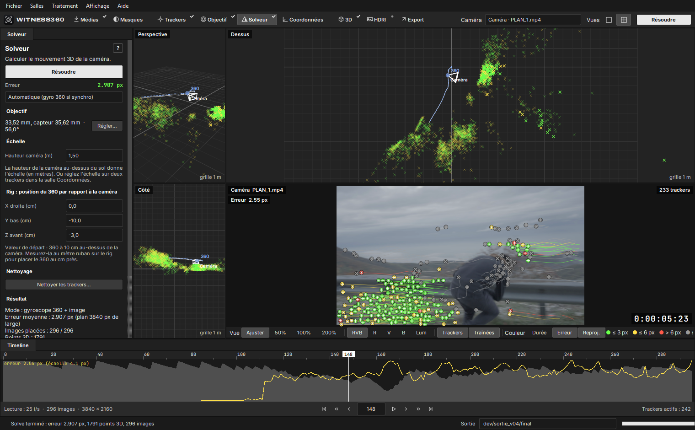

Les trackers prennent la couleur de leur erreur (vert ≤ 3 px en 4K, jaune ≤ 6 px, rouge au-delà, gris sans position
3D). La croix blanche est le point 3D reprojeté.

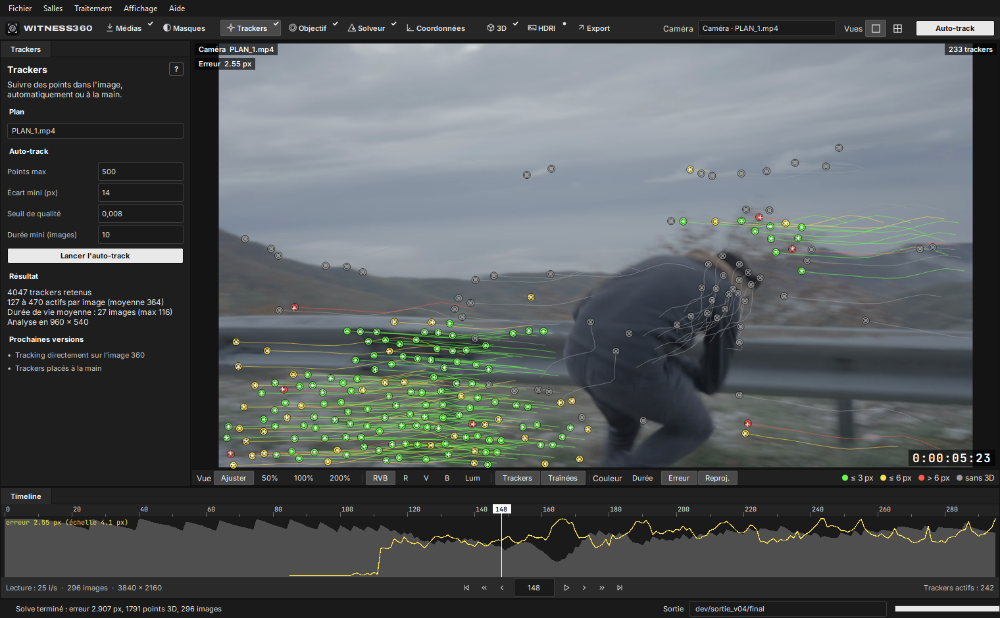

### 5. Placer la scène

Salle **Coordonnées** : on clique des trackers dans la vue caméra, puis **Origine**, **Sol** (3 trackers ou plus),
**Axe X** ou **Échelle** (distance réelle entre 2 trackers). Le repère est rejoué après chaque solve.

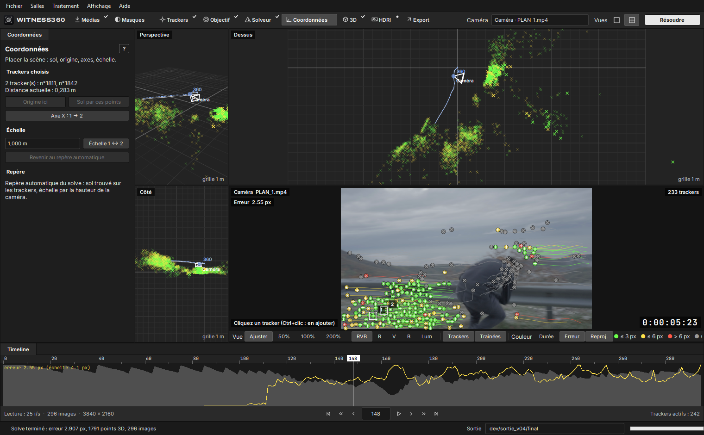

### 6. Les deux caméras en 3D

Les vues 3D montrent les points des trackers, la trajectoire de la caméra (trait plein) et celle du 360 (tirets).
**F** ou un double-clic cadre le rig.

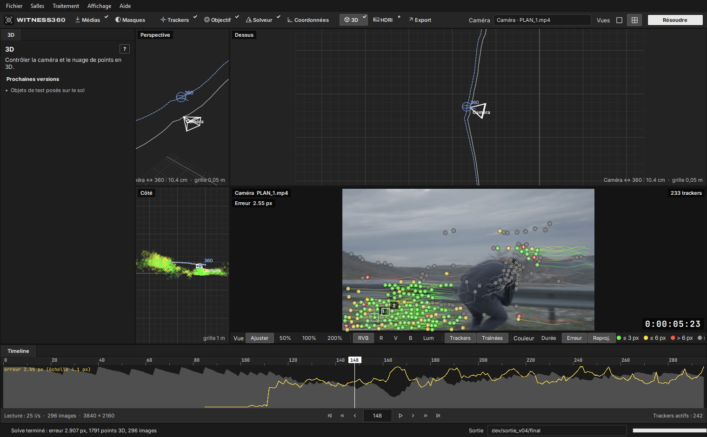

### 7. HDRI étalonné sur le plan

Salle **HDRI** (Ctrl+H) : un HDRI `.exr` linéaire tiré du 360, à l'image choisie. Le rig est masqué
automatiquement ; le 360 est comparé au plan pixel à pixel pour reprendre sa couleur et son exposition (un gris à 18 %
vu par le plan vaut 0,18 dans l'HDRI). En orientation **Scène trackée**, l'HDRI est posé dans le repère de la caméra
exportée : rien à tourner dans Blender.

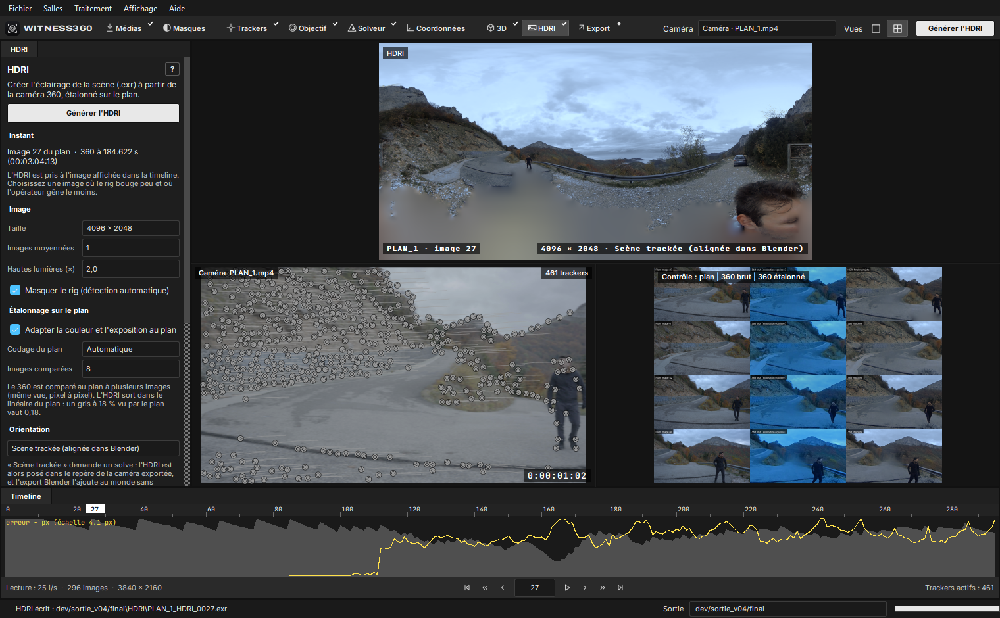

Vérification sur PLAN_1 (rendu Cycles depuis la caméra exportée, monde seul) : l'HDRI retombe sur la plaque 4K à
0,5 à 15 px près pour les éléments lointains, avec une lumière ×0,91 à ×1,04 dans les ombres, ×1,00 à ×1,05 dans les
tons moyens et ×0,99 à ×1,02 dans les hautes lumières. PLAN_2, plus difficile (peu de décor commun entre le plan et
le 360) : 35 à 68 px, tons moyens ×0,96 à ×0,97. L'opérateur qui tient le rig reste visible en bas de l'HDRI.

### 8. Export vers Blender

**Exporter vers Blender** (Ctrl+E) écrit un `.abc` (caméra animée, 360 témoin, nuage de points) et un `.blend` (plaque
en fond de caméra, cadence et résolution du plan, HDRI comme monde). Réimporté dans Blender, l'Alembic reprojette les
trackers à 2,24 px sur PLAN_1 et 2,26 px sur PLAN_2 (médiane, pixels 4K).

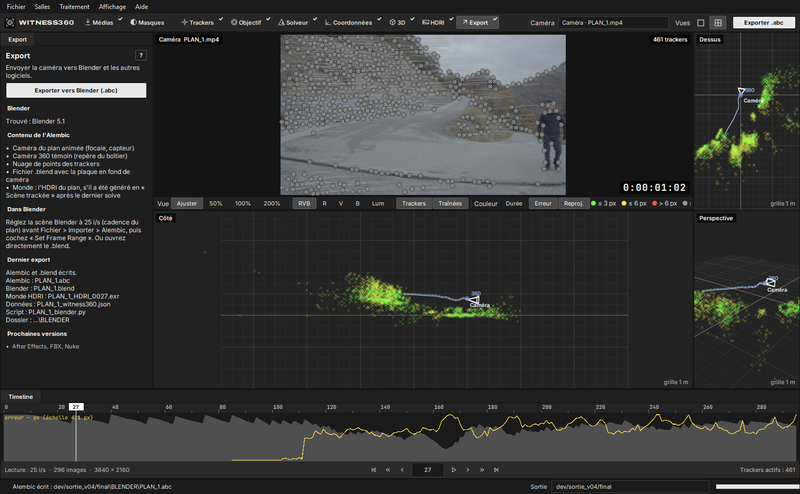

Le projet s'enregistre (Ctrl+S, fichier `.w360`) et se rouvre tel quel, médias compris si le dossier a été déplacé.

### 9. Mise à jour automatique

Au démarrage, witness360 regarde s'il existe une version plus récente sur cette page et propose de l'installer :
elle la télécharge, vérifie son empreinte SHA-256 (`SHA256SUMS.txt`), se ferme et redémarre. Vérification manuelle :
menu Aide > Rechercher les mises à jour.

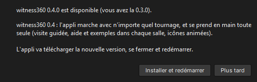

## Montages : découpage en plans et synchro par l'image

Importez un montage déjà coupé : l'appli trouve les coupes à l'image près et en fait un plan par plan (menu Plans >
Regrouper pour annuler). Un rush de caméra reste une seule prise. À la synchro, chaque plan est placé dans le 360 par
le son, et vérifié par l'image ; quand le son ne correspond pas, le plan est retrouvé par l'image : son mouvement est
comparé à celui du rig vu par le gyroscope du 360 sur tout le fichier, puis le plan est cherché dans l'image 360.

| Test | Coupes | Synchro par l'image (sans le son) |
|---|---|---|
| Montage de 4 morceaux des vrais plans (S-Log3, rig FX3 + ONE X2), sur une musique | 3 coupes sur 3, à l'image près | Les 4 plans retrouvés dans le 360 de 4 min 30 ; écart constant de 135 ms avec le son, qui est la latence image / son de la caméra |
| Montage de synthèse de 4 plans d'environ 1 s, sur une musique | 3 coupes sur 3, à l'image près | Les 4 plans retrouvés, à 0,1 s près |

## Autotest

Chaque version est vérifiée sur Windows et sur Mac par `witness360 --autotest` : un tournage de synthèse (pièce
texturée, rig caméra + Insta360 ONE X2 simulée avec son gyroscope, son commun, latence de la caméra) dont tout est
connu. Toute la chaîne passe : découpage, synchro, auto-track, mesure de l'angle de vue sur le 360, solve, horloges,
HDRI, export, projet.

| Contrôle | Mac (appli compilée, macOS 26, Apple Silicon) | Windows (appli en Python) | Vérité |
|---|---|---|---|
| Découpage du montage de synthèse | coupes 30, 66, 94 | coupes 30, 66, 94 | 30, 66, 94 |
| Synchro | à 0,0 ms, « son + image » | à 0,0 ms, « son + image » | |
| Angle de vue mesuré sur le 360 | 54,99° | 55,00° | 55,00° |
| Horloge du plan sur le gyroscope | à 4,4 ms | à 1,2 ms | |
| Solve, puis affinage | 0,71 px, puis 0,47 px | 0,95 px, puis 0,50 px | |
| Trajectoire de la caméra | écart médian 10 mm sur 1,43 m | écart médian 23 mm sur 1,43 m | |
| HDRI : rapport HDRI / plan (tons moyens) | 1,005 | 1,002 | 1,00 |
| Export Alembic par Blender, projet relu | écrits, relu | écrits, relu | |
| Durée | 4 min 30 | 9 min | |

L'appli compilée pour Windows passe aussi l'autotest sur le serveur de GitHub (15 contrôles sur 15 ; Blender n'y est pas installé, l'export Alembic est vérifié sur le poste de travail).

## Autres tournages testés

| Cas | Résultat |
|---|---|
| Vidéo 360 équirectangulaire, sans gyroscope | Synchro, angle de vue (56,15°), solve sur l'image seule (1,73 px), HDRI et export |
| Sony A7 IV, Rec.709, 12-24 mm, rushes de 4 à 15 min | Boîtier, objectif, focale et capteur lus ; le 360 retrouvé dans le seul rush qui le recouvre (±9 ms), les autres rejetés |
| Caméra fixe, loin du rig | Pas assez de décor commun avec le 360 : l'appli le signale et sort un HDRI aux couleurs du 360 |

## Feuille de route

| Version | Contenu |
|---|---|
| 0.1 | Import, synchro audio 360, auto-track, versions Windows et Mac, mise à jour automatique |
| 0.2 | Solve caméra aidé par le gyroscope 360, nettoyage des trackers, vues 3D, export Alembic vers Blender |
| 0.2.1 | Plans 4K de bout en bout |
| 0.3 | HDRI tiré du 360, étalonné sur le plan, posé dans la scène Blender |
| 0.4 | Tout tournage : calages mesurés sur les fichiers, toute caméra de plan et toute caméra 360, 9 courbes de couleur, rushes longs, projets. Salles Objectif, Coordonnées et Masques. Visite guidée, aide et exemples dans chaque salle, icônes animées |
| 0.5 | Montages découpés en plans, synchro son + image, autotest sur tournage de synthèse, Mac (raccourcis, pavé tactile, écrans 13 pouces), fiabilité (horloges, masque du rig, journal, annulation) |
| Prochaine | Opérateur retiré de l'HDRI, distorsion des objectifs, tracking directement sur l'image 360 |

## Configuration

- Windows 10 ou 11 (64 bits), ou Mac Apple Silicon sous macOS 12 ou plus récent.
- Blender (facultatif, pour écrire l'Alembic et le .blend ; sinon l'appli écrit le script à lancer).
