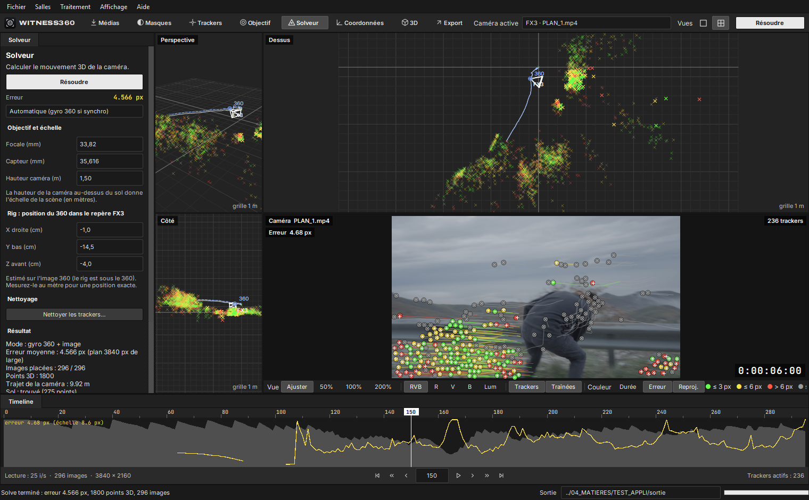
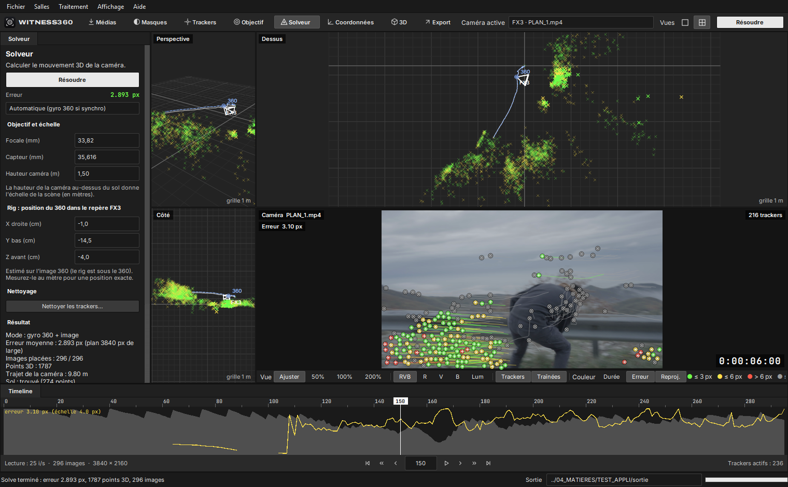
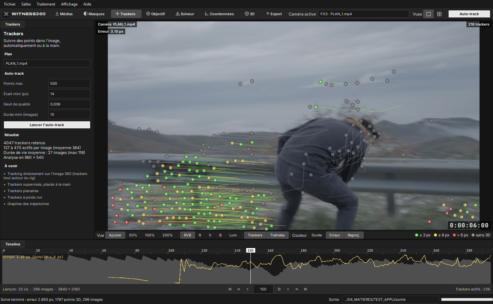
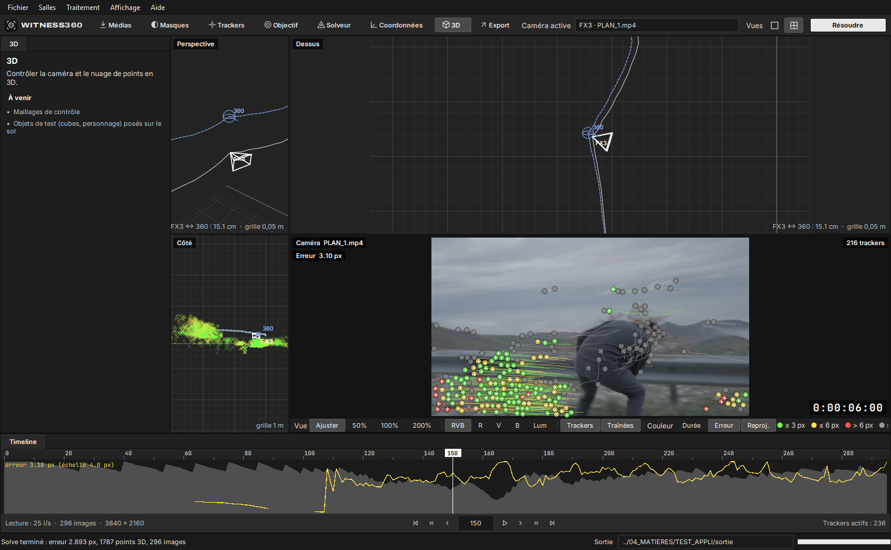
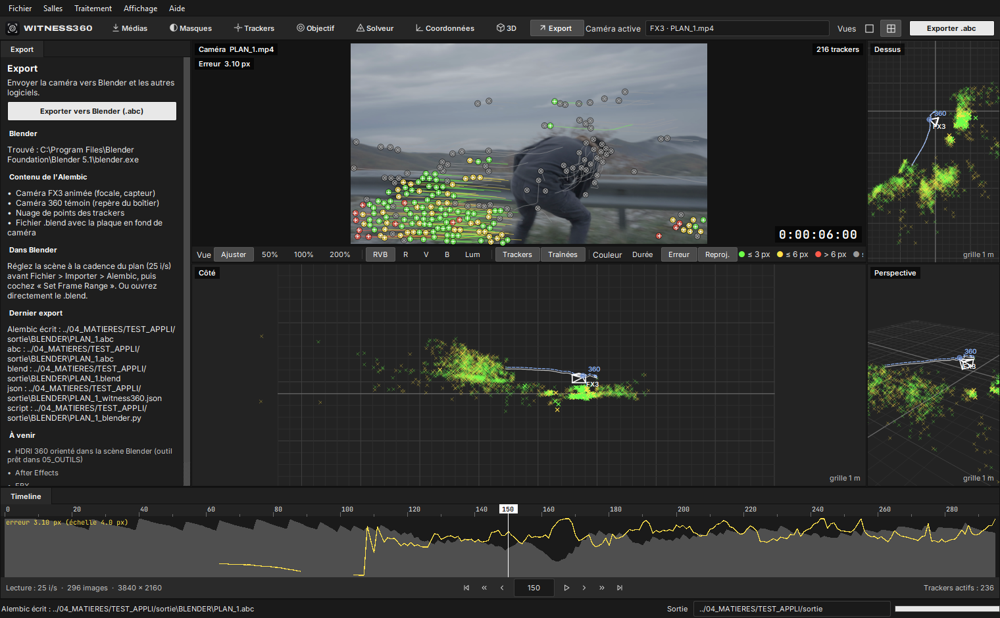

  <picture>
    <source media="(prefers-color-scheme: dark)" srcset="assets/witness360_logo_sombre.png">
    
  </picture>

# witness360

Tracking caméra aidé par une caméra 360 « témoin » montée sur le rig, livré dans Blender.

Ce dépôt sert à distribuer les versions compilées de witness360 (Windows et Mac). Le code source est dans un dépôt privé.

## Télécharger

**[Dernière version](../../releases/latest)**

| Système | Fichier |
|---|---|
| Windows 10 / 11 (64 bits) | `witness360-X.Y.Z-windows-x64.zip` |
| Mac Apple Silicon (M1 et plus récents), macOS 12 ou plus | `witness360-X.Y.Z-macos-arm64.zip` |

**Windows** : décompressez le zip dans un dossier à vous (par exemple `Documents\witness360`) et lancez `witness360.exe`.
Si Windows affiche « Windows a protégé votre ordinateur », cliquez sur « Informations complémentaires » puis « Exécuter quand même ».

**Mac** : décompressez le zip et glissez `witness360.app` dans `Applications`. L'appli n'est pas encore signée par Apple :
au premier lancement, faites clic droit sur l'appli puis « Ouvrir » (ou Réglages Système > Confidentialité et sécurité > « Ouvrir quand même »).

## Mises à jour automatiques

Au démarrage, witness360 regarde s'il existe une version plus récente sur cette page. Si oui, elle propose de l'installer :
elle la télécharge, vérifie son empreinte SHA-256 (`SHA256SUMS.txt`), se ferme et redémarre sur la nouvelle version.
Vérification manuelle : menu Aide > Rechercher les mises à jour.

## Exemple : une scène réelle, pas à pas

Scène de test : 2 plans tournés à la Sony FX3 en 4K (3840 × 2160, 25 i/s) avec une Insta360 ONE X2 montée
sur le même rig. Le fichier 360 dure 9 min 53 s. Les plans durent 11 s et 9 s.

### 1. Importer et synchroniser

On glisse le `.insv` et les deux plans dans la fenêtre, puis on clique sur **Synchroniser**.
witness360 retrouve chaque plan dans la 360 par le son et le place sur la timeline 360, avec sa vignette.

| Plan | Début retrouvé dans la 360 | Images 360 | Contrôle | Fiabilité |
|---|---|---|---|---|
| PLAN_1 (296 images) | 00:03:03:11 (183,542 s) | 5500,8 → 5855,6 | 3 morceaux à ±0,5 ms | Sûre |
| PLAN_2 (238 images) | 00:04:04:09 (244,540 s) | 7328,9 → 7614,2 | 3 morceaux à ±1,9 ms | Sûre |

Le contrôle recale 3 morceaux de chaque plan séparément. Si l'écart entre eux reste sous une demi-image, la synchro est
classée « Sûre ». Sinon, elle passe en « À vérifier ».

### 2. Tracker le plan

Salle **Trackers** : on lance l'auto-track sur le plan choisi.
Les points sont suivis image par image, avec un contrôle aller-retour.
La couleur dit combien de temps chaque point a été suivi :

- vert : 40 images ou plus ;
- jaune : de 20 à 39 images ;
- rouge : moins de 20 images.

En bas, la timeline montre le nombre de trackers actifs sur chaque image.

Sur PLAN_1, l'auto-track garde 4034 trackers, avec 100 à 470 trackers actifs par image (349 en moyenne).
Un tracker est suivi 26 images en moyenne, et jusqu'à 116.
Les points sont suivis sur une image réduite à 960 px de large, plus robuste au flou des panoramiques, puis reportés
sur le plan 4K. Sur cette scène, suivre en pleine résolution ne réduisait pas l'erreur du solve.

La vue simple agrandit l'image. Vous pouvez y zoomer (50 à 200 %), afficher un seul canal (R, V, B, luminance) et
afficher ou masquer les traînées.

### 3. Résoudre la caméra (solve)

Salle **Solveur**, bouton **Résoudre** (Maj+G).

- **Rotation** : le gyroscope du 360 donne la rotation du rig à chaque image. L'appli cale elle-même le
  gyroscope sur l'image du plan. Sur cette scène, l'image FX3 arrive 138 ms après le son, sur les deux plans.
- **Position et points** : la position de la caméra et celle des points viennent des trackers (triangulation, PnP,
  ajustement de faisceaux).
- **Verticale** : elle vient de l'accéléromètre du 360.
- **Échelle** : elle vient de la hauteur de la caméra au-dessus du sol.

L'erreur s'affiche en pixels du plan, dans le panneau et image par image (courbe jaune de la timeline).
Les trackers prennent la couleur de leur erreur. Les seuils suivent la largeur du plan :

| Couleur | Plan de 1920 px | Plan 4K (3840 px) |
|---|---|---|
| vert | 1,5 px ou moins | 3 px ou moins |
| jaune | 3 px ou moins | 6 px ou moins |
| rouge | plus de 3 px | plus de 6 px |
| gris | pas de position 3D | pas de position 3D |

Les trackers posés sur la personne qui bouge sont rejetés : ils restent gris.

### 4. Nettoyer les trackers puis affiner

**Nettoyer les trackers** (Maj+C) retire, chacun avec son seuil :

- les mauvaises images d'un tracker ;
- les trackers à forte erreur ;
- les trackers courts ;
- les trackers lointains ;
- les sauts isolés.

Le solve est ensuite affiné. Sur PLAN_1, l'erreur passe de 4,57 px à 2,89 px (pixels 4K).

Dans la vue caméra, chaque tracker garde sa couleur d'erreur. La croix blanche est le point 3D reprojeté, et le trait
montre l'écart avec le tracker.

### 5. Les deux caméras dans la scène 3D

Les vues 3D montrent :

- les points des trackers (×) ;
- la trajectoire de la FX3 (trait plein) et celle du 360 (tirets) ;
- les deux caméras à leur position.

**F** ou un double-clic cadre le rig ; ici, la FX3 et le 360 sont à 15,1 cm l'un de l'autre.
Le choix **Caméra active** passe de la FX3 d'un plan à la caméra 360 témoin.

### 6. Export Alembic vers Blender

**Exporter vers Blender (.abc)** (Ctrl+E) lance Blender en arrière-plan. Il écrit :

- un `.abc` avec la caméra FX3 animée, le 360 témoin et le nuage de points ;
- un `.blend` avec la plaque en fond de caméra.

Vérification : une fois réimporté dans Blender, l'Alembic reprojette les trackers à 2,23 px sur PLAN_1 et
2,15 px sur PLAN_2 (médiane, pixels 4K). Le `.blend` est réglé en 3840 × 2160, avec la plaque 4K en fond.
Dans Blender, réglez la scène à la cadence du plan (25 i/s) avant **Fichier > Importer > Alembic**, ou ouvrez
directement le `.blend`.

### 7. Mise à jour automatique

Quand une nouvelle version est publiée ici, l'appli la propose au démarrage :

## Feuille de route

| Version | Contenu |
|---|---|
| 0.1 | Import, synchro audio 360, auto-track, versions Windows et Mac, mise à jour automatique |
| 0.2 | Solve caméra aidé par le gyroscope 360, nettoyage des trackers, affinage, vues 3D avec la FX3 et le 360, export Alembic vers Blender |
| 0.2.1 | Plans 4K de bout en bout (erreurs en pixels 4K, `.blend` en 3840 × 2160), caméra recentrée d'un demi-pixel |
| Prochaine | Tracking directement sur l'image 360 (trackers tout autour du rig), solve combiné des deux caméras |
| Ensuite | Masques (opérateur), objectif FX3 (métadonnées, distorsion), HDRI 360 dans la scène Blender |

## Configuration

- Windows 10 ou 11 (64 bits), ou Mac Apple Silicon sous macOS 12 ou plus récent.
- Caméra 360 : Insta360 ONE X2, fichiers `.insv` non stabilisés.
