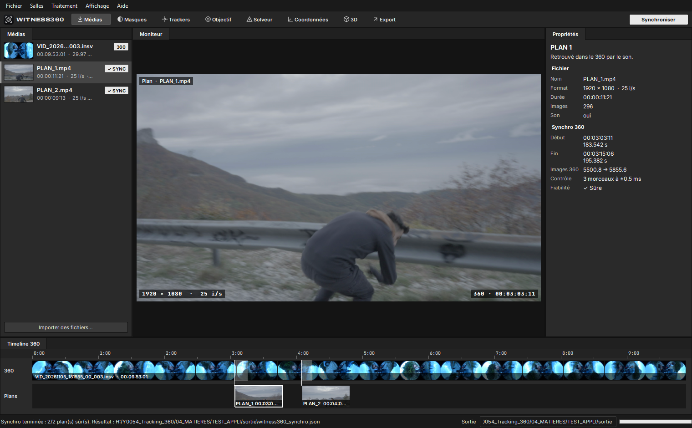
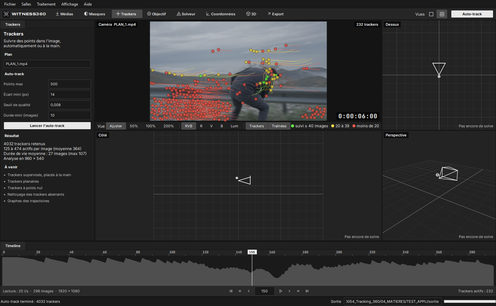
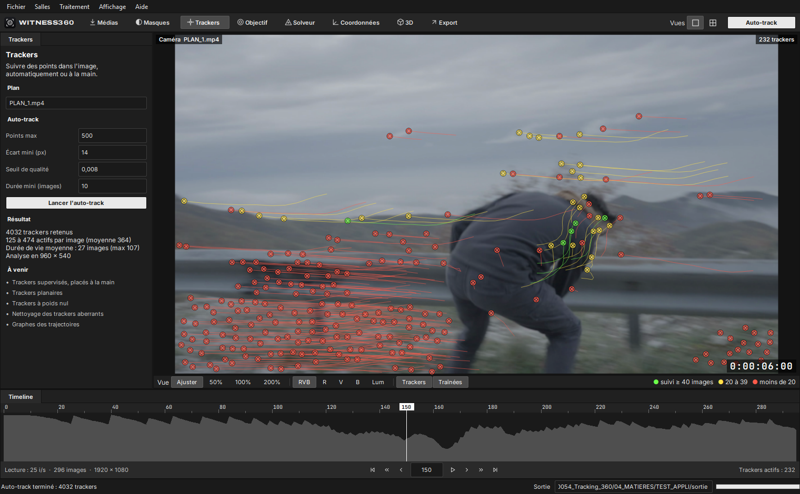
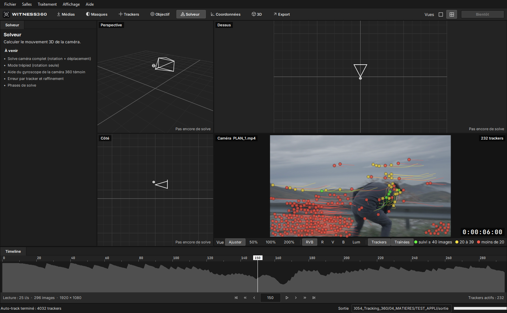
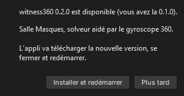

  <picture>
    <source media="(prefers-color-scheme: dark)" srcset="assets/witness360_logo_sombre.png">
    
  </picture>

# witness360

Tracking caméra aidé par une caméra 360 « témoin » montée sur le rig, livré dans Blender.

Ce dépôt sert à distribuer les versions compilées de witness360 (Windows et Mac). Le code source est dans un dépôt privé.

## Télécharger

**[Dernière version](../../releases/latest)**

| Système | Fichier |
|---|---|
| Windows 10 / 11 (64 bits) | `witness360-X.Y.Z-windows-x64.zip` |
| Mac Apple Silicon (M1 et plus récents), macOS 12 ou plus | `witness360-X.Y.Z-macos-arm64.zip` |

**Windows** : décompressez le zip dans un dossier à vous (par exemple `Documents\witness360`) et lancez `witness360.exe`.
Si Windows affiche « Windows a protégé votre ordinateur », cliquez sur « Informations complémentaires » puis « Exécuter quand même ».

**Mac** : décompressez le zip et glissez `witness360.app` dans `Applications`. L'appli n'est pas encore signée par Apple :
au premier lancement, faites clic droit sur l'appli puis « Ouvrir » (ou Réglages Système > Confidentialité et sécurité > « Ouvrir quand même »).

## Mises à jour automatiques

Au démarrage, witness360 regarde s'il existe une version plus récente sur cette page. Si oui, elle propose de l'installer :
elle la télécharge, vérifie son empreinte SHA-256 (`SHA256SUMS.txt`), se ferme et redémarre sur la nouvelle version.
Vérification manuelle : menu Aide > Rechercher les mises à jour.

## Exemple : une scène réelle, pas à pas

Scène de test : 2 plans tournés à la Sony FX3 (25 i/s) avec une Insta360 ONE X2 montée sur le même rig.
Le fichier 360 dure 9 min 53 s. Les plans durent 11 s et 9 s.

### 1. Importer et synchroniser

On glisse le `.insv` et les deux plans dans la fenêtre, puis on clique sur **Synchroniser**.
witness360 retrouve chaque plan dans la 360 par le son et le place sur la timeline 360, avec sa vignette.

| Plan | Début retrouvé dans la 360 | Images 360 | Contrôle | Fiabilité |
|---|---|---|---|---|
| PLAN_1 (296 images) | 00:03:03:11 (183,542 s) | 5500,8 → 5855,6 | 3 morceaux à ±0,5 ms | Sûre |
| PLAN_2 (238 images) | 00:04:04:09 (244,540 s) | 7328,9 → 7614,2 | 3 morceaux à ±1,9 ms | Sûre |

Le contrôle recale 3 morceaux de chaque plan séparément. Si l'écart entre eux reste sous une demi-image, la synchro est
classée « Sûre ». Sinon, elle passe en « À vérifier ».

### 2. Tracker le plan

Salle **Trackers** : on lance l'auto-track sur le plan choisi.
Les points sont suivis image par image, avec un contrôle aller-retour.
La couleur dit combien de temps chaque point a été suivi :

- vert : 40 images ou plus ;
- jaune : de 20 à 39 images ;
- rouge : moins de 20 images.

En bas, la timeline montre le nombre de trackers actifs sur chaque image.

Sur PLAN_1, l'auto-track garde 4032 trackers, avec 125 à 474 trackers actifs par image (364 en moyenne).
Un tracker est suivi 27 images en moyenne, et jusqu'à 107.

La vue simple agrandit l'image. Vous pouvez y zoomer (50 à 200 %), afficher un seul canal (R, V, B, luminance) et
afficher ou masquer les traînées.

### 3. Les salles suivantes

Masques, Objectif, Solveur, Coordonnées, 3D et Export suivent la logique d'un logiciel de matchmove.
Chaque salle liste déjà ses fonctions prévues. Dans le Solveur, par exemple :

- solve complet ;
- mode trépied ;
- aide du gyroscope de la caméra 360 ;
- erreur par tracker.

### 4. Mise à jour automatique

Quand une nouvelle version est publiée ici, l'appli la propose au démarrage :

## Feuille de route

| Version | Contenu |
|---|---|
| 0.1 | Import, synchro audio 360, auto-track, versions Windows et Mac, mise à jour automatique |
| Prochaine | Masques (rig, opérateur), objectif FX3 (focale lue dans les métadonnées) |
| Ensuite | Solve caméra aidé par le gyroscope 360, export Blender `.abc` + HDRI 360 |

## Configuration

- Windows 10 ou 11 (64 bits), ou Mac Apple Silicon sous macOS 12 ou plus récent.
- Caméra 360 : Insta360 ONE X2, fichiers `.insv` non stabilisés.
